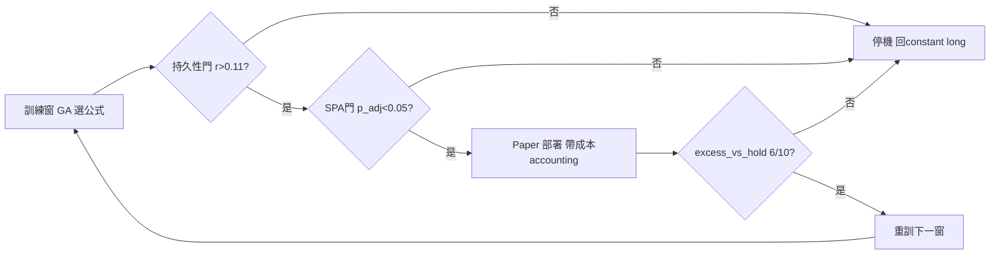

# AlphaGPT 28c 投資分析報告與結論方向（2026-10-29 收斂版）

> **專案大原則**：系統性找出能賺錢的法則並做系統性驗證。回測驗證出正獲利（扣成本、贏 hold、贏 null、可重複），就接交易所做自動化交易。
> **地位**：NO-GO。除非 selection-rule 五臂翻案，否則不交易、不加倉、不重訓上線。
> 本文件收斂 2026-10-29 三軌研究（標準/對抗/橫向）結論，數學門與執行順序寫死。

## 1. 現況判決

* Real excess `-2.74±0.03`，null `-1.10±0.08`，gap `-1.64±0.09, t=-18.6`（n=1000 配對，seeds 501-1000）。
* Null 打敗 buy-hold `27.6%`（138/500），real 僅 `0.4%`（2/500），70x 倒掛。
* Breadth `+7.08 幣, t=+24.4`（real 21.0/28 vs null 14.0/28），但轉不成 excess，就是 drift + 付成本。
* P2 pre-gate：`excess_vs_hold 0/10`，7/10 選出 `std<0.001` 固定 long，`corr(Sharpe,|position|)=+0.65`。
* 選擇機制：`argmax_margin 0.009` vs `overfit_gap 0.70`（78x near-tie），`corr(train,valid)=-0.09`。
* 成本機制：turnover 懲罰 spread `0.000502` 佔總 reward spread `0.6187` 的 `0.08%`，小四個量級，動量免費。
* 舊 Y1B 好看數字（ETC 2.91、ETC+TRX H2 2.20/FULL 2.34）量的是 validation leak（修前後同 seed 差 ~8 Sharpe），不可引用。

詳見 `REALNULL_1000_2026-10-03.md`、`P2_PREGATE_DIAGNOSIS.md`。

## 2. 糾正：四個數字的正確讀法

| 數字 | 誤讀 | 正確 |
|---|---|---|
| Gap -1.64 | real -1.64 vs null +0.30 | real -2.74 減 null -1.10，real 顯著更差 |
| Beat-rate | real 更會贏 | 27.6% 是 null，real 僅 0.4% |
| Breadth | 78x 幣數 | +7.08 幣；78x 是 margin/scatter near-tie 比 |
| Turnover 0.08% | 換手率低 | 懲罰項佔總 spread 比例，成本看不見 |

## 3. 三道數學門（全過才能談 sizing）

### M1 持久性：DSR 校準 + Spearman

$H_0: \rho=0$，$H_1: \rho>0$，n=500。$se_z=1/\sqrt{497}\approx0.0449$，
$r_{crit}\approx0.074$，$MDE_r\approx0.11$，$MDE_{gap}\approx0.23$。
FINAL_SPEC 要求壓縮 ≥0.40，高於 MDE，檢定力足夠。
過門：$p_{one}<0.05$ 且 $r>0.11$。

### M2 多重檢定：White Reality Check / SPA

M≥4（S0、A1、FM、N0、B1），$T_W=\max_m|d_m|/SE_m$，bootstrap B≈2000 得 $p_{adj}$。
過門：$p_{adj}<0.05$。N0 跟著壓縮判 shared confound，不是 partial win。

### M3 成本定價：Turnover-aware Lagrangian

$$L(w;\lambda) = Sharpe(w) - \lambda(\tau(w)-\tau_{target})$$

定標 $\lambda\sigma_\tau \approx \sigma_{IC} \approx 0.0257$，
$\sigma_\tau\approx0.10$ 則 $\lambda\approx0.26$（現 `w_turn=0.02` 差一個量級，sweep 0.5→1.0）。
M3 是新假說，獨立預註冊，不進 FINAL_SPEC 五臂。

Kelly（$f^*=\mu/\sigma^2$）、UP/ONS 全部 deferred：$\mu>0$ OOS 確立前談倉位是送錢。
Avellaneda-Stoikov excluded：做市庫存模型，與方向性 GA 不同遊戲。

## 4. 五條失效向量與熔斷器

1. **Leak 復發**：scatter/margin > 50 拒收該折全部基因（現 78x）。
2. **成本低估**：$w_{turn}\sqrt{Var(IC)}<10^{-4}$ 或權重 x10 邊際不動即停。
3. **Beta 偽裝**：breadth gap / |excess gap| > 4（現 +7.08 vs -1.64）退回單因子。
4. **倖存者偏差**：real beat-rate ≤ null x1.25（現 0.014）連兩臂即回 constant long。
5. **重訓加速虧**：corr(train,valid)≤0 不得提高重訓頻率；變異版反超恆定版 >0.5 即停。

## 5. 執行順序（不可調序）

1. FM（1.00x）→ 2. S0 gate（相關性 ~1.0，否則全停）→ 3. A1+N0（2.10x）→ 4. B1 pilot（150 seeds）。
   總 ~4.6 S0-batch，可斷點續跑。
2. 判讀（FINAL_SPEC 寫死）：壓縮 ≥0.40 + real-flat/null-down + 70x→<20x + N0 ±0.20 內 = 翻案；
   N0 跟動 = shared confound 關 GA；全 ±0.20 內 = 因子沒東西關 GA。
3. 翻案才做 M3 獨立預註冊；再 paper 閉環（修 pytest-asyncio + 真憑證）；最後 Kelly 半分數起步。
4. 不做的事：不加因子/不加 generation/不定時重訓/不還原原版/不談複利。

## 6. 可上線的重訓循環形狀

缺任何一道門，循環就是虧錢加速器。corr -0.09 下提高重訓頻率 = 提高抽獎頻率。

## 7. 資產（關 GA 也保留）

* Null 27.6% baseline：以後任何 k-of-n beat-hold 先過此關。
* Leak ~8 Sharpe 量尺：同 seed 前後對照。
* 預註冊 + N0 負控制流程：`docs/selection_rule/FINAL_SPEC.md`。
* 免費診斷 C1+timescale（2026-10-29，零 GA 成本，fidelity 1.0000，n=2000 train 窗）：
  S0 +2.57 / A1 +1.64 / N0 +1.16（train 窗 fitness，min 聚合弱降 level 屬預期，只看 gap 不看 raw）；
  同窗半半 rank corr：1/3 切分 -0.094，1/2 切分 +0.40（p=1.2e-77），2/3 切分 +0.39。
  半窗 horizon 有結構，但這是窗內相關，與跨折 corr(train,valid)=-0.09 並存，不構成翻案，待五臂驗證。

---
## 8. 專案目標（2026-10-29 更新）

本專案的目標就是投資回報：用可驗證的量化方法，在加密永續市場找到扣成本、贏 hold、贏 null、可重複的策略，並部署為帶風控的自動交易系統。本文件即投資建議，虧損自負。

當前投資判斷：NO-GO，不投入本金、不上槓桿、不做定時重訓上線。唯一例外是按 FINAL_SPEC 跑完五臂所需的計算成本（約 4.6 S0-batch），那是研究支出，不是部位。

翻案條件（三道門全過）：M1 $r>0.11$、M2 $p_{adj}<0.05$、M3 turnover 可見且 gap 壓縮 ≥0.40 帶 real-flat/null-down + N0 不動。達成前任何實盤投入視為違反本目標。
